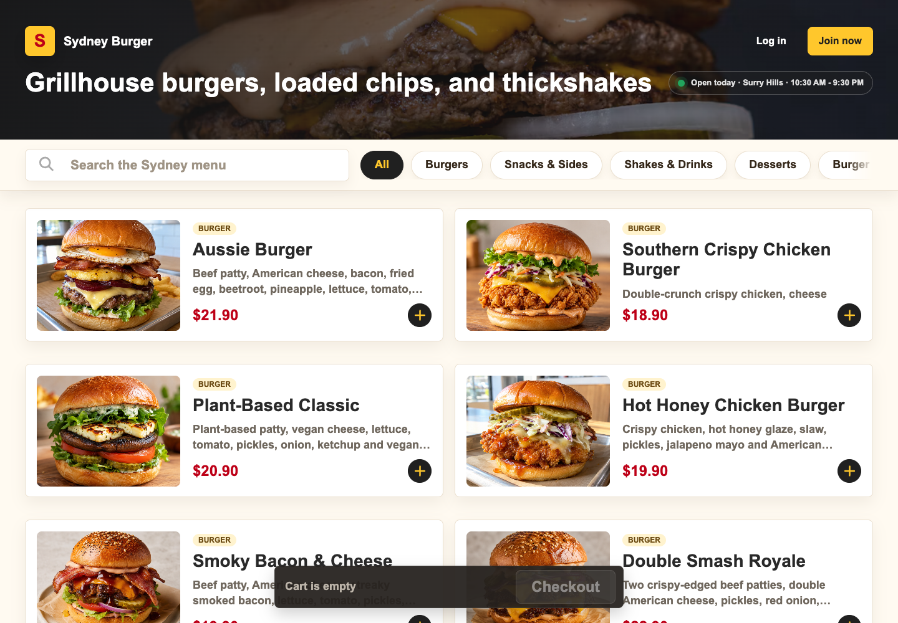
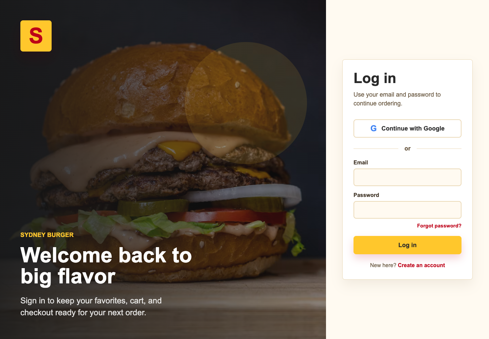
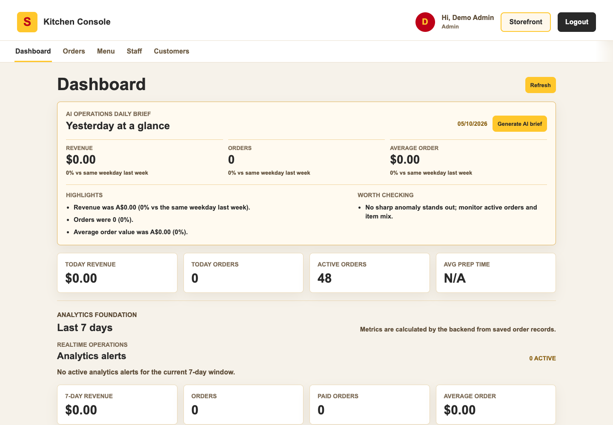
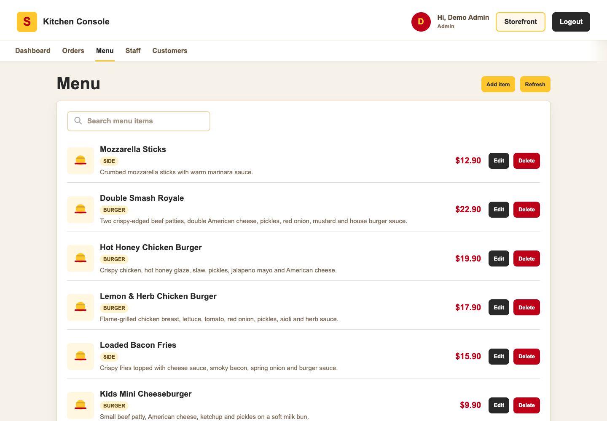
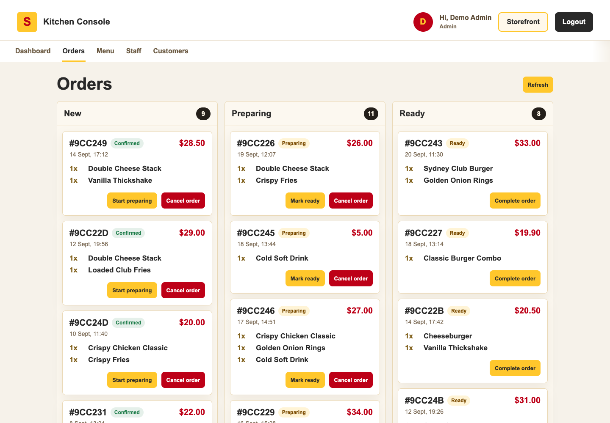
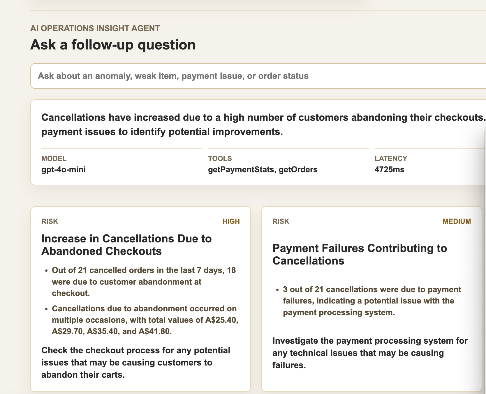
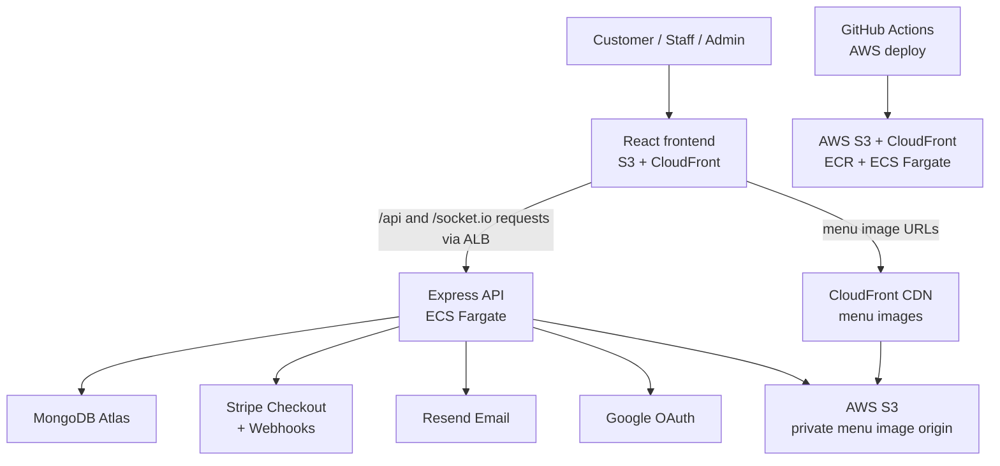

# Sydney Burger (Burger Club)

Sydney Burger is an independently built full-stack restaurant ordering portfolio
project, branded Burger Club in the application. It
models a realistic local burger shop workflow: customers browse an AUD menu,
validate cart totals against the backend, pay with Stripe Checkout, and track
recent orders while staff manage orders and menu changes.

- **Live Demo (AWS):** [https://www.sydneyburger.com](https://www.sydneyburger.com)
- **Backend API (AWS):** [https://api.sydneyburger.com/api/health](https://api.sydneyburger.com/api/health)

> **Demo, not a trading business:** Stripe is in test mode. Analytics includes
> explicitly marked synthetic orders and simulated revenue, not commercial
> customers or sales. Staff and admin views require authorised access; local
> seed credentials are not published live-demo credentials.

## Project Walkthrough

1. **Customer:** browse the menu, build a cart, validate current prices, enter
   test-mode Checkout, and view order history.
2. **Staff:** manage orders through the kitchen workflow and maintain menu
   availability using role-based permissions.
3. **Admin:** inspect sales, product mix, payment outcomes and cancellations
   over 7 or 30 days, then generate an AI brief or ask a follow-up question.

The core engineering work connects these workflows: server-owned pricing,
payment reconciliation, session recovery, realtime updates, analytics and
bounded AI explanations. See the screenshots below for restricted admin views.

## Portfolio Highlights

- Built a production-style MERN ordering system for a Sydney restaurant concept
  with AUD cents-based pricing, customer checkout, staff workflows, and deployed
  live demo.
- Implemented Stripe Checkout with webhook signature verification and
  idempotent order payment updates, persisted checkout attempts, and a MongoDB
  outbox worker for payment notifications. Payment state comes from trusted
  backend events instead of frontend return URLs.
- Designed an authentication flow with JWT access tokens, HttpOnly refresh
  cookies, refresh-token rotation, CSRF origin/header checks, password hashing,
  email verification, Google OAuth, and rate-limited auth routes.
- Added backend cart quote validation, menu-version checks, and order snapshots
  so Stripe line items are created from server-validated checkout data.
- Built an AI operations insight layer over deterministic MongoDB analytics,
  including daily briefs, alert investigation, backend-selected read-only
  tools, and agent-run logging. Real `gpt-4o-mini` responses have been verified
  against the deployed demo dataset.
- Added authenticated Socket.IO realtime flows for kitchen order operations,
  customer order status updates, menu updates, and analytics alerts with
  polling fallback only when realtime is unavailable.
- Moved menu images to a private S3 origin served through CloudFront, with the
  backend issuing presigned upload URLs and storing CDN URLs on menu items.
- Deployed the live app on S3, CloudFront, ECR and ECS Fargate behind an
  Application Load Balancer, with MongoDB Atlas, Resend and Stripe integrations.

## Tech Stack

| Area     | Stack                                                                                 |
| -------- | ------------------------------------------------------------------------------------- |
| Frontend | React 19, TypeScript, React Router, CSS Modules, Vite, Socket.IO client               |
| Backend  | Node.js, Express, TypeScript, Mongoose, Zod                                           |
| Database | MongoDB                                                                               |
| Payments | Stripe Checkout, Stripe webhook signature verification                                |
| Auth     | Email/password, Google OAuth, JWT access tokens, HttpOnly refresh-cookie sessions     |
| AI/Ops   | OpenAI gpt-4o-mini, Zod response validation, deterministic fallback, AgentRun logging |
| Assets   | AWS S3 private origin, CloudFront menu image CDN                                      |
| Testing  | Jest, Vitest, React Testing Library, ts-jest                                          |
| Tooling  | Stripe CLI, npm scripts, GitHub Actions                                               |

## System Architecture

```text
React customer app
  |-- REST API: menu, cart validation, checkout, profile orders
  |-- Socket.IO: menu updates, customer order status updates
  v
Express API
  |-- Auth/RBAC: customer, staff, admin permissions
  |-- Order state machine: pending_payment -> confirmed -> preparing -> ready -> completed
  |-- Stripe webhook reconciliation
  |-- Outbox worker for paid-order email and realtime notifications
  |-- MongoDB aggregation for dashboard analytics
  |-- AI operations insight agent over verified backend data
  |-- S3 presigned uploads and CloudFront image URLs
  v
MongoDB Atlas
  |-- menu items
  |-- order snapshots
  |-- users, sessions, staff invites
  |-- audit logs and agent runs
  |-- webhook claims and outbox events

Stripe Checkout -> signed webhook -> Express -> MongoDB -> outbox worker -> email / Socket.IO
Staff Kitchen Board -> status update -> Express -> MongoDB -> customer/admin events
```

## Core Features

- Sydney-local restaurant ordering experience with AUD pricing.
- Categorized infinite-scroll menu feed with search, availability states,
  pagination, realtime menu versions, and polling fallback.
- Realistic restaurant menu coverage across burgers, sides, drinks, desserts,
  and combos, including featured and sold-out availability states.
- Menu images stored as CloudFront URLs backed by private S3 objects.
- Backend cart validation so checkout totals are calculated server-side before
  order creation.
- Stripe Checkout flow with signed webhook handling and order-snapshot line
  items.
- Payment lifecycle updates for success, failed, cancelled, and repeated webhook events.
- Checkout recovery across reloads using per-user persisted idempotency keys;
  changed carts send previous attempt keys so the backend can close older
  unpaid Stripe Sessions before preparing a replacement.
- Order history and payment-return handling that treats Stripe webhooks as the
  source of payment truth.
- Authenticated WebSocket admin events for order and menu changes, allowing the
  staff dashboard to refresh without manual reloads.
- Realtime kitchen board workflow for confirmed, preparing, ready, completed,
  and cancelled orders.
- Customer authentication with Google OAuth and refresh-token recovery.
- Production security headers, API rate limiting, and stricter authentication
  throttling.
- Staff/admin order console and menu management, including category and
  availability updates.
- Staff invitation flow with token validation.
- Email workflows for verification, reset password, and order confirmation.
- AI daily brief, analytics alerts, alert investigation, admin chat, and
  read-only analytics tools for evidence-grounded operational recommendations.
- Seed scripts for local menu and demo users.

## Frontend Highlights

- In-memory access token storage, with refresh tokens kept out of JavaScript in
  HttpOnly cookies.
- API wrapper compatible with refresh-cookie sessions, CSRF headers, request
  timeouts, retry handling, and automatic refresh-and-retry on eligible `401`
  responses.
- Single-flight refresh logic so concurrent expired requests share one refresh
  request instead of racing the rotated refresh token.
- Debounced background cart quote refreshes that keep displayed totals aligned
  with backend-calculated AUD cents.
- Explicit user-action quote validation before checkout, with menu-version
  conflict handling and price-change notices.
- Local cart persistence so customers can leave and return without losing their
  basket.
- Checkout reuses a valid cart quote and refreshes it when necessary. Price
  changes pause payment for review; restored checkouts retain their original
  order snapshot and require review if it differs from the displayed quote.
- Confirmed payments clear only the matching saved checkout and unchanged cart,
  preserving newer carts and attempts. An older paid checkout is acknowledged
  on its order page before the customer continues with their current cart.
- Role-aware customer/admin routing and auth state managed through a dedicated
  auth provider.

## Admin Analytics Foundation

The admin dashboard includes deterministic analytics over saved order records.
`GET /api/admin/dashboard/analytics?range=7d` uses MongoDB aggregation to
calculate revenue, order counts, average order value, category sales, top
items, lower-selling items, and payment status counts. These metrics are
computed by the backend rather than the AI layer, giving future admin AI
insights a verified data foundation to explain.

Analytics uses the restaurant's `Australia/Sydney` business day for today
metrics. Revenue, paid order counts, category sales, and item sales are
attributed by `payment.paidAt`, while order-count and payment-status funnel
metrics remain based on order creation time. Order item snapshots include
`categoryAtPurchase` so historical category reporting is not affected by later
menu edits, and lower-selling items include current menu items with zero sales.
The dashboard also tracks attachment rates such as burger orders with sides or
drinks, using item category snapshots instead of current menu category lookup.

The dashboard also exposes deterministic analytics alerts for high cancellation
rate, low paid-order rate, and revenue drops versus the previous period. Order
events can trigger `analytics:alert` over the authenticated admin WebSocket
channel so staff can see operational risks without refreshing the page.
Admins can then investigate an alert with the AI insight agent, which reloads
trusted analytics and active alert context before generating an evidence-based
recommendation. Follow-up questions reuse the same grounded alert investigation
endpoint instead of relying on unbounded chat memory. When a manager asks to see
orders by status, the agent can call a restricted `getOrders` tool that returns
only operational order evidence, not customer private data.

The daily brief is productized for a restaurant owner rather than exposed as a
generic model response. The backend combines deterministic daily metrics,
active alerts, and model output into a structured `dailyBrief` payload with a
headline, priority, focus areas, and next checks. This lets the dashboard show
what deserves attention today without asking the owner to interpret raw charts.

Local demos can run `ALLOW_DEMO_ORDER_SEED=true npm run seed:demo-orders`
after seeding users and menu items to create realistic 30-day order history
for the analytics dashboard. The script replaces only orders whose
`checkoutIdempotencyKey` starts with `demo-order-`. Existing older order
records can be snapshot-backfilled by adding
`BACKFILL_EXISTING_ORDER_SNAPSHOTS=true`, which fills missing
`categoryAtPurchase`, `payment.paidAt`, `cancellationReason`, and
`cancelledAt` fields from existing order and menu data.

## Realtime Operations Flow

The backend exposes Socket.IO channels for public menu subscribers,
authenticated customers, and authenticated staff/admin users. Realtime events
use small payloads such as `order:paid`, `order:updated`, `order:cancelled`,
`menu:updated`, and `analytics:alert`.

```text
Customer checkout
  -> Stripe Checkout
  -> signed Stripe webhook
  -> backend marks order confirmed and payment paid
  -> backend enqueues an order.paid outbox event
  -> worker sends the confirmation email and emits order:paid
  -> admins and the order owner's user room receive the update
  -> Kitchen Board updates and customer order page updates

Staff Kitchen Board
  -> Start preparing / Mark ready / Complete order
  -> backend validates the order state transition and version
  -> MongoDB order is updated
  -> order:updated emitted to admins and the customer

Admin disables customer
  -> user status becomes disabled
  -> active sockets in user:<id> are disconnected
```

Order pages use WebSocket payloads to update visible order status locally when
the order is already loaded. New orders, missing orders, and aggregate admin
dashboard data still trigger REST refreshes so MongoDB and backend analytics
remain the source of truth. Admin Orders and Admin Dashboard fall back to
30-second polling only when the authenticated realtime connection disconnects
or cannot be established. Public menu clients keep the same behavior for menu
version changes.

## AI Operations Insight Agent

The admin dashboard includes an AI operations insight agent that turns verified
analytics into operational attention, not unbounded chat. The backend first
computes metrics with MongoDB aggregation, detects active alerts, and exposes
restricted read-only tools such as `getPaymentStats`, `getItemPerformance`,
`getOrders`, and `getAttachmentRates`. The model can then explain what
happened, cite the evidence, describe a likely explanation only when the data
supports it, and recommend what the manager should check next.

Tool selection is application-controlled, not an unrestricted model-driven
agent loop. The backend calculates the metrics; the model explains them. A
recorded model name and tool list make the execution inspectable, but do not
by themselves prove every generated explanation is correct.

```text
Orders in MongoDB
  -> deterministic aggregation tools
  -> analytics summary and active alerts
  -> selected read-only tools
  -> AI insight agent
  -> evidence-grounded operational attention cards
  -> productized daily brief or alert investigation
  -> follow-up alert, order, item, payment, and attachment-rate checks
  -> AgentRun logging for model, tool, latency, status, and cost estimate
```

Cancellation alert investigation uses a bounded V2 workflow. It always starts
with the analytics summary and cancelled order evidence, builds a cancellation
breakdown, then records a `branchDecision` before selecting the next focused
tool: payment outcome check, item/category concentration check, time-window
check, or insufficient-signal. This keeps the agent explainable and prevents an
unbounded autonomous loop.

Each insight run is recorded in an `AgentRun` document with the agent name,
prompt, selected backend tools, latency, status, and optional cost estimate.
The agent is intentionally constrained: it may recommend checks, but it does
not automatically change menu items, prices, payments, refunds, or orders. If
`OPENAI_API_KEY` is not configured, deterministic fallback insights still use
the same verified analytics and run logging, so the demo remains usable without
external AI spend.

## Live Demo Notes

- Stripe runs in test mode and does not create real charges.
- Google sign-in and session persistence after refresh were manually verified
  on the official www/api domains.
- On 28 October 2026, 392 marked synthetic orders were added for the preceding
  30 complete Sydney dates. All 84 pre-existing orders were preserved; repeat
  application inserted and modified nothing. See the
  [dataset record](docs/demo-month-dataset-2026-10-28.md) for its boundaries.
- AI monthly analysis, daily briefs and an admin follow-up were verified using
  `gpt-4o-mini`. These demonstrate analysis of a portfolio dataset, not real
  business performance or proven causes of customer behaviour.
- Full signed Stripe Checkout-to-order reconciliation, email delivery and
  authenticated realtime notification flows were not reverified in the latest
  production check. Unit tests are not a substitute for those integration checks.
- One live AI brief exceeded the four-card response limit and was rejected by
  schema validation; a retry succeeded. Tighter provider output constraints
  remain a known reliability improvement, not a completed fix.

## Verification Snapshot

The backend suite passed 240 tests across 44 suites on 28 October 2026, including
six tests for the deterministic monthly dataset. Backend type checking, lint
and formatting checks passed. Unit tests explicitly disable the real AI key.

AWS ECS revision 108 completed a stable rollout and the official API health
endpoint returned HTTP 200. The API key is injected from AWS Secrets Manager,
not embedded in the frontend or plaintext task-definition environment.
See the [production check record](docs/production-check-2026-10-28.md) for
verified results and outstanding integration checks.

## Screenshots

| Storefront menu                               | Login                                       | Admin dashboard                                          |
| --------------------------------------------- | ------------------------------------------- | -------------------------------------------------------- |
|  |  |  |

| Admin menu management                                     | Kitchen order board                                       |
| --------------------------------------------------------- | --------------------------------------------------------- |
|  |  |

### AI Operations Follow-Up

Actual admin result over synthetic orders: model, selected tools, latency and
metric-backed attention cards. Recommendations remain hypotheses to check,
not proof of a checkout or payment-system defect.



## Local Setup

### 1. Install dependencies

Run these commands from the repository root. Node.js 22 and a running local
MongoDB instance or MongoDB Atlas connection are required.

```bash
npm --prefix shared ci
npm --prefix shared run build
npm --prefix backend ci
npm --prefix frontend ci
```

### 2. Configure environment variables

```bash
cp backend/.env.example backend/.env
cp frontend/.env.example frontend/.env
```

Update `backend/.env` with your MongoDB URI and a `JWT_SECRET` containing at
least 32 characters. Add Stripe test keys when testing the payment flow.
The examples use `http://localhost:5173` for the frontend and
`http://localhost:5001` for the API. Keep `FRONTEND_URL`, `TRUSTED_ORIGINS`, and
Stripe return URLs aligned with the frontend origin; `VITE_API_URL` should be
the backend origin without `/api`.

For local Stripe webhooks, run this in a separate terminal:

```bash
stripe listen --forward-to localhost:5001/api/stripe/webhook
```

Copy the printed `whsec_...` value into `STRIPE_WEBHOOK_SECRET`, then restart
the backend.

### 3. Seed local data

```bash
cd backend
npm run seed:meals
npm run seed:demo-users
ALLOW_DEMO_ORDER_SEED=true npm run seed:demo-orders
```

### 4. Run the app

Terminal 1:

```bash
cd backend
npm run dev
```

Terminal 2:

```bash
cd frontend
npm start
```

Open [http://localhost:5173](http://localhost:5173).

## Environment Configuration

Use [`backend/.env.example`](backend/.env.example) as the source of truth for
backend configuration. Local development requires `MONGO_URI` and a
`JWT_SECRET` with at least 32 characters. Backend URL settings have local
defaults and can be overridden when needed.

Stripe Checkout requires `STRIPE_SECRET_KEY` and `STRIPE_WEBHOOK_SECRET`.
Google sign-in requires `GOOGLE_CLIENT_ID` and `GOOGLE_CLIENT_SECRET`. Email
delivery through Resend is optional.

Menu images are stored in AWS S3 and served through CloudFront. The backend uses
S3 presigned URLs for admin image uploads when `AWS_REGION` and
`S3_MENU_IMAGES_BUCKET` are set, then stores a CloudFront image URL in MongoDB.
`S3_MENU_IMAGES_PUBLIC_BASE_URL` can override the default CloudFront domain,
for example when moving to a custom CDN domain.

The frontend should set `VITE_API_URL` to the backend origin, for example
`https://api.sydneyburger.com`, when WebSocket admin events are enabled.
REST requests can still be routed through relative `/api` rewrites, but the
Socket.IO client needs a stable backend origin for the realtime connection.

## AWS Deployment

The live demo uses AWS. The deployment is documented
in [`docs/aws-deployment.md`](docs/aws-deployment.md), with the frontend
to S3 + CloudFront and the backend to ECS Fargate through ECR and an Application
Load Balancer.

The manual `Deploy AWS` GitHub Actions workflow supports `frontend` (default),
`backend`, or `both`. Frontend deployment uploads `frontend/dist` to S3 and
invalidates CloudFront. Backend deployment pushes a Docker image to ECR and
updates an existing ECS service and task definition. Provision the required
AWS resources separately; this workflow does not create an ALB, VPC, or ECS
service. Running ECS tasks and an ALB incur costs independently of workflow runs.

## Technical Design Docs

The project includes design notes for the main engineering decisions:

- [`docs/architecture.md`](docs/architecture.md) explains the frontend/backend
  structure, permission model, data integrity rules, and observability approach.
- [`docs/auth-design.md`](docs/auth-design.md) covers refresh-token rotation,
  OAuth state handling, email verification, and permission-based access.
- [`docs/order-state-machine.md`](docs/order-state-machine.md) documents order
  transitions, permission rules, optimistic concurrency, and failure cases.
- [`docs/stripe-webhook-design.md`](docs/stripe-webhook-design.md) explains
  webhook signature verification, idempotency, payment matching, and late event
  handling.
- [`docs/deployment.md`](docs/deployment.md) summarizes the production topology,
  domains, environment variables, webhooks, and operational checks.

## Test Commands

```bash
cd backend
npm run lint
npm run typecheck
npm run format:check
npm test
npm run build

cd ../frontend
npm run lint
npm run typecheck
npm run format:check
npm test
npm run build
```

Run `npm run format` in either project to format its source files, or
`npm run format:check` to check formatting without changing files.

## Architecture



The frontend is split around pages, domain stores, API clients, and reusable UI
components. Cart state lives in a dedicated cart provider, while silent quote
refreshes, user-triggered quote validation, and menu-version polling are handled
through cart-specific hooks. Profile and auth pages keep request orchestration
inside page hooks so UI components stay focused on rendering.

The backend follows a route-controller-service-repository shape. Controllers
handle HTTP input and status codes, services own business rules, repositories
wrap MongoDB access, and Zod schemas validate request bodies. Stripe webhooks are
mounted before JSON parsing with `express.raw()` so signature verification uses
the original request body.

The backend applies Helmet security headers, limits JSON request bodies to
100 KB, and rate-limits the general API. Login and verification attempts use a
stricter limiter, while higher-cost actions such as signup, password recovery,
and email verification use the strictest limiter. Stripe webhooks remain outside
the general limiter so valid provider retries are not blocked.

Payment truth comes from Stripe webhooks, not the frontend success redirect. The
frontend payment-return page validates the returned order id format and only
routes the user to the relevant order page; order status is read back from the
backend.

Menu images are stored as CloudFront HTTPS URLs on each menu item. S3 keeps the
original image objects, CloudFront serves public image traffic, and the React
frontend renders the URL returned by the backend. The ECS API signs uploads and
never stores image files on its local filesystem. Menu image source backups live
in `docs/assets/menu-image-originals`; they are outside `frontend/public` and
are not included in the frontend build.

All monetary values are stored and transferred as integer AUD cents
(`priceCents`, `subtotalCents`, `totalCents`, and `amountCents`). Stripe receives
the validated integer `priceCents` value directly as its minor-unit amount.

## Local Demo Accounts

For local development only, run `npm run seed:demo-users` in `backend` first.
The seed refuses to run in production. These credentials do not grant access
to the deployed admin console; do not enable predictable seed passwords in a
public environment. Live administrator access is managed separately.

| Role     | Email                      | Password      |
| -------- | -------------------------- | ------------- |
| Customer | `customer@burgerclub.test` | `Burger#2026` |
| Admin    | `admin@burgerclub.test`    | `Burger#2026` |

## Stripe Test Card

Use Stripe test mode card `4242 4242 4242 4242` with any future expiry date and
any three-digit CVC.
